### Essai 01 — Régulateur proportionnel**

Conditions : route droite, vitesse de 60 km/h, écart initial de −0,2 m, Kp = 0,5, Ki = 0 et Kd = 0.

La voiture présente des oscillations dont l'amplitude augmente progressivement. Vers 3,7 secondes, l'écart atteint environ −2 m et vers 5,2 secondes, il atteint environ −4,5 m. La voiture sort de la route après environ 6 secondes.

Pour le deuxième essai, je vais diminuer Kp de 0,5 à 0,25 afin de vérifier si un gain proportionnel plus faible réduit les oscillations et améliore la stabilité de la direction.
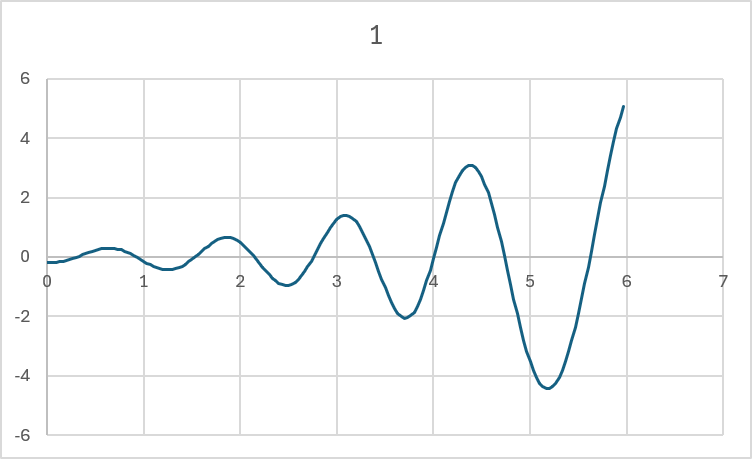

### Essai 02 — Diminution du gain proportionnel**

Avec Kp = 0,25, Ki = 0 et Kd = 0, les oscillations continuent d'augmenter progressivement. La voiture sort de la route vers 10,5 secondes, comparativement à environ 6 secondes lors du premier essai avec Kp = 0,5.

La diminution de Kp ralentit donc la croissance des oscillations, sans stabiliser la voiture.

Pour le prochain essai, je conserve Kp = 0,25 et j'ajoute Kd = 0,1 afin de vérifier si l'action dérivée permet de réduire les oscillations.
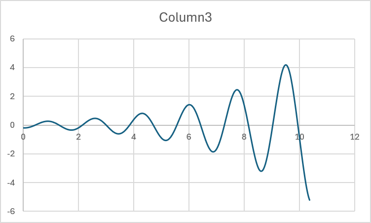

### Essai 03 — Ajout du terme dérivé**

Avec l'ajout du terme dérivé, les oscillations sont maintenant amorties. La voiture commence à −0,20 m, dépasse le centre d'environ 0,067 m et se stabilise après approximativement 4 à 5 secondes.

Ce résultat montre que le terme D améliore considérablement la stabilité de la direction par rapport au régulateur proportionnel seul.

Pour le prochain essai, je vais doubler Kd afin de vérifier s'il est possible de diminuer davantage le dépassement du centre de la voie.
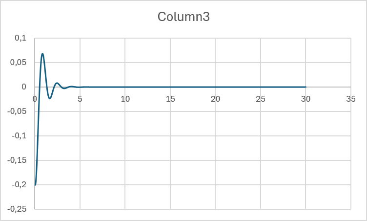

### Essai 04 — Augmentation du terme dérivé (Kd)

**Conditions :** Route droite, vitesse de 60 km/h, écart initial de −0,2 m, Kp = 0,25, Ki = 0 et Kd = 0,106.

En doublant Kd de 0,053 à 0,106, la voiture revient beaucoup plus rapidement au centre de la voie. Contrairement à l'essai 03, où elle dépassait le centre d'environ 6,7 cm, le dépassement est maintenant presque nul. La voiture semble se stabiliser en environ 1 à 2 secondes et reste au centre pendant les 30 secondes de l'essai.

**Conclusion :** L'augmentation de Kd a permis de mieux amortir les oscillations. Je vais conserver ces gains pour le prochain essai dans un virage afin de vérifier si une erreur permanente apparaît et si l'ajout du terme intégral (Ki) est nécessaire.

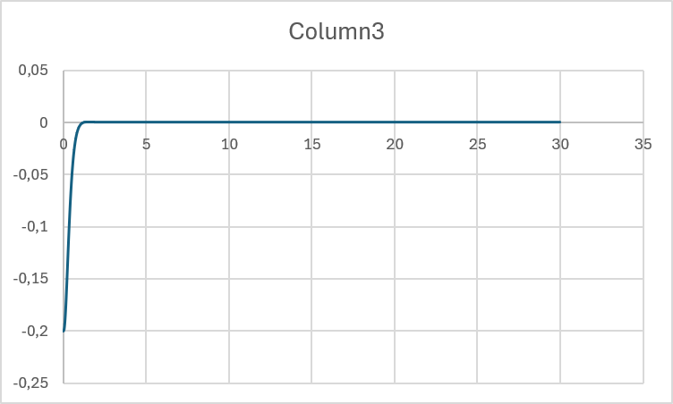

### Essai 05 — Direction dans un virage

**Conditions :** Route VIRAGE, vitesse de 60 km/h, écart initial de 0 m, Kp = 0,25, Ki = 0 et Kd = 0,106.

La voiture se stabilise après environ 3 secondes, mais elle conserve un écart permanent d'environ −0,50 m par rapport au centre de la voie. Le régulateur PD permet donc de stabiliser la voiture, mais ne réussit pas à éliminer cette erreur.

Pour le prochain essai, je vais ajouter Ki = 0,025 afin que le terme intégral accumule l'erreur et permette à la voiture de se rapprocher du centre de la voie.
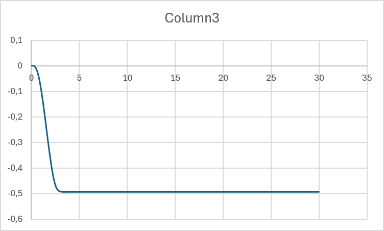

### Essai 06 — Ajout du terme intégral (Ki)

**Conditions :** Route VIRAGE, vitesse de 60 km/h, écart initial de 0 m, Kp = 0,25, Ki = 0,025 et Kd = 0,106.

En ajoutant Ki = 0,025, la voiture corrige progressivement l'erreur permanente observée à l'essai 05. Elle atteint d'abord un écart maximal d'environ −0,45 m après 3 secondes, puis revient lentement vers le centre de la voie. Après 30 secondes, il reste environ 3 cm d'écart, comparativement aux 50 cm de l'essai précédent.

Le terme intégral permet donc de réduire l'erreur permanente, mais la correction est encore trop lente.

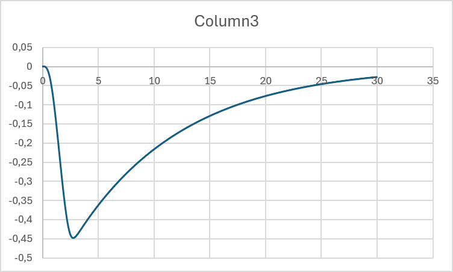

### Essai 07 — Augmentation du gain intégral

**Conditions :** Route VIRAGE, vitesse de 60 km/h, écart initial de 0 m, Kp = 0,25, Ki = 0,08333 et Kd = 0,106.

Pour cet essai, j'ai augmenté Ki de 0,025 à 0,08333 afin d'obtenir un temps intégral théorique de 3 secondes, soit deux fois ma période d'oscillation de 1,5 seconde.

La voiture atteint un écart maximal d'environ −0,38 m, comparativement à −0,45 m lors de l'essai précédent. Elle revient ensuite progressivement au centre de la voie et se stabilise vers 15 à 17 secondes, sans oscillations importantes.

**Conclusion :** L'augmentation de Ki permet de corriger l'erreur permanente plus rapidement, tout en conservant une bonne stabilité. Je vais conserver ce réglage pour tester le comportement de la voiture dans les courbes fortes.
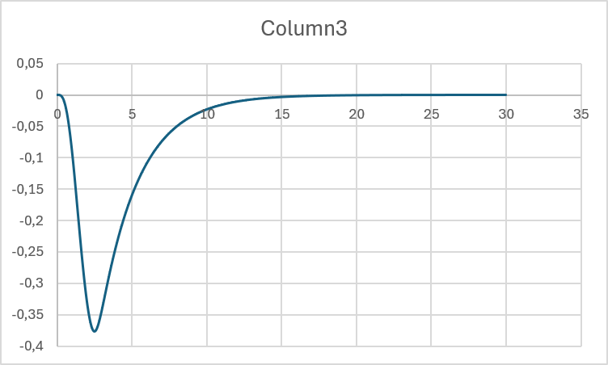

### Essai 08 — Test dans les courbes fortes

**Conditions :** Route COURBES_FORTES, vitesse de 60 km/h, écart initial de 0 m, Kp = 0,25, Ki = 0,08333 et Kd = 0,106.

Avec les mêmes paramètres que l'essai 07, j'ai testé le comportement de la voiture dans les courbes fortes. La voiture atteint un écart maximal d'environ +0,38 m vers 5 secondes. Elle présente ensuite plusieurs variations de position, notamment −0,20 m vers 13 secondes et +0,23 m vers 22 secondes.

Malgré ces variations, les écarts ne semblent pas augmenter continuellement et la voiture revient régulièrement vers le centre de la voie.

**Conclusion :** Le réglage PID obtenu semble convenir aux courbes fortes. Je vais conserver ces paramètres pour la suite du laboratoire, sous réserve de confirmer que la voiture a terminé le parcours sans sortie de route.

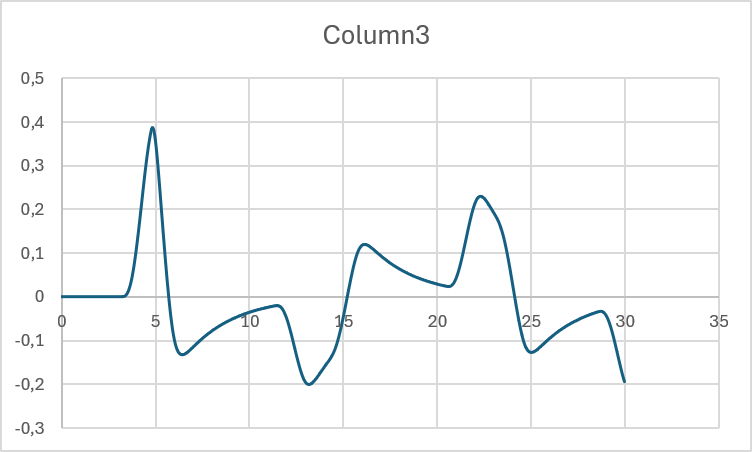

### Essai 10 — Réglage de la vitesse avec P seulement

**Conditions :** Scénario ECHELON, Kp = 0,1, Ki = 0 et Kd = 0.

Au départ, la consigne est de 70 km/h. Après environ 8 secondes, elle passe à 90 km/h. La voiture accélère progressivement et se stabilise à environ 85,26 km/h après 20 secondes.

Il reste donc une erreur permanente de 4,74 km/h par rapport à la consigne. Le régulateur proportionnel seul ne permet pas d'atteindre exactement la vitesse demandée.

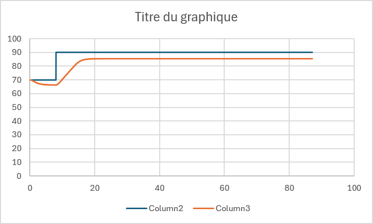

### Essai 11 — Augmentation du gain proportionnel

**Conditions :** Scénario ECHELON, Kp = 0,4, Ki = 0 et Kd = 0.

En augmentant Kp de 0,1 à 0,4, la voiture réagit plus fortement à la différence entre la vitesse réelle et la consigne. Lorsque la consigne passe de 70 à 90 km/h, la voiture accélère et se stabilise autour de 88,5 km/h, sans oscillations importantes.

L'erreur permanente diminue donc d'environ 4,74 km/h à 1,5 km/h. Le réglage est meilleur, mais la voiture n'atteint toujours pas exactement la consigne.

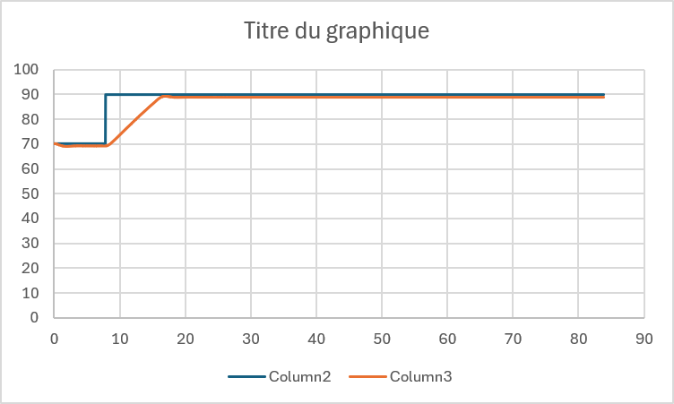

### Essai 12 — Ajout du terme intégral (Ki)

**Conditions :** Scénario ECHELON, Kp = 0,4, Ki = 0,08 et Kd = 0.

J'ai ajouté Ki = 0,08 afin d'obtenir un temps intégral de 5 secondes (Ti = Kp / Ki). La voiture atteint maintenant la consigne de 90 km/h, contrairement à l'essai précédent où il restait une erreur permanente.

Cependant, la vitesse dépasse la consigne et atteint environ 101 km/h vers 22 secondes, soit un dépassement de 11 km/h. Elle redescend ensuite progressivement et se stabilise autour de 90 km/h vers 40 secondes.

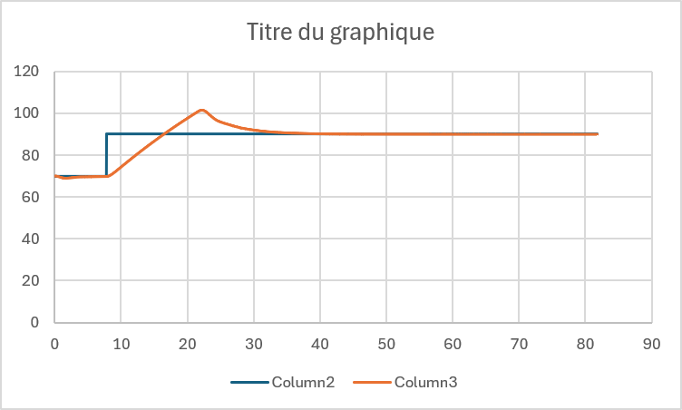

### Essai 13 — Diminution du gain intégral

**Conditions :** Scénario ECHELON, Kp = 0,4, Ki = 0,04 et Kd = 0.

J'ai diminué Ki de 0,08 à 0,04 pour augmenter le temps intégral de 5 à 10 secondes. La voiture atteint maintenant une vitesse maximale d'environ 97 km/h, comparativement à 101 km/h lors de l'essai précédent.

Le dépassement diminue donc de 11 à environ 7 km/h. La voiture revient progressivement à la consigne de 90 km/h et se stabilise vers 45 secondes.

**Conclusion :** La diminution de Ki permet de réduire le dépassement, mais ralentit légèrement la stabilisation. Je vais conserver ce réglage comme compromis entre la précision et la rapidité de réponse.

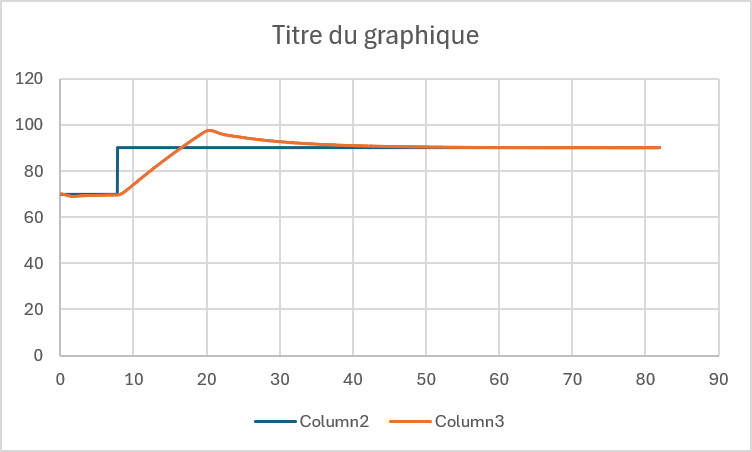

### Essai 14 — Scénario PALIERS

**Conditions :** Kp = 0,4, Ki = 0,04 et Kd = 0.

J'ai testé mon régulateur de vitesse avec le scénario PALIERS, qui fait passer la consigne de 30 à 50, 70, 90 et finalement 100 km/h.

La voiture réussit à atteindre les différentes consignes. Cependant, elle présente des dépassements temporaires, notamment environ 7 km/h lors des passages à 70 et 90 km/h. Après chaque dépassement, la vitesse redescend progressivement et se stabilise près de la valeur demandée.

**Conclusion :** Le régulateur PI fonctionne à différentes vitesses et élimine l'erreur permanente. Il reste toutefois des dépassements lors des accélérations.

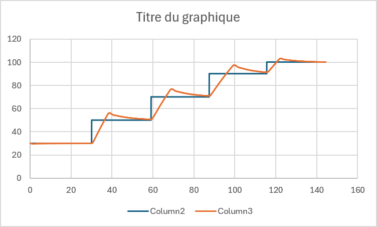

Conditions : Scénario PALIERS, Kp = 0,25, Ki = 0,08333 et Kd = 0,106 pour la direction.

À 30 km/h, la voiture reste relativement proche du centre de la voie, avec des écarts maximaux d'environ 6 à 7 cm. À 100 km/h, les variations deviennent plus importantes et peuvent atteindre environ 12 à 13 cm.

La direction demeure stable dans l'ensemble, sans oscillations qui augmentent continuellement. Cependant, les écarts observés sont plus importants à haute vitesse.

Conclusion : Le PID de direction fonctionne à différentes vitesses, mais son comportement change avec la vitesse. Il pourrait être avantageux d'utiliser des gains différents selon la vitesse pour améliorer la précision, ce qui sera étudié à l'étape 8.

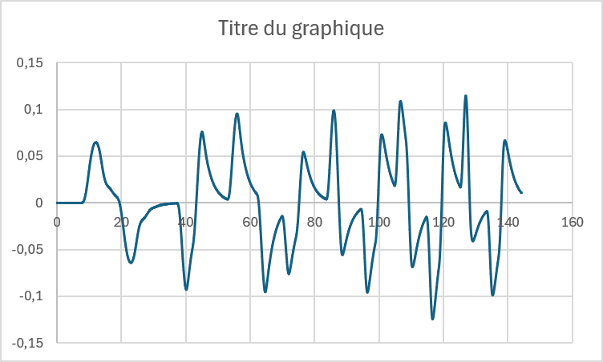

### Étape 5 — Réglage du PID au clavier

J'ai testé le réglage du PID directement au clavier avec Kp = 0,5, Ki = 0,2 et Kd = 0,2, en utilisant l'intégration conditionnelle.

Pendant l'essai, j'ai effectué plusieurs changements de voie. La voiture réussit à suivre les consignes, mais présente certains dépassements. Elle atteint notamment +3,838 m pour une consigne de 3,5 m.

Contrairement à l'étape 2, le programme permet de modifier les gains sans devoir arrêter et relancer manuellement le programme. Chaque changement de gain produit un nouvel essai enregistré dans un fichier CSV.

Cette méthode facilite les essais successifs, mais il faut conserver les mêmes conditions pour comparer correctement les gains.

1. Pourquoi seule ControlTask communique-t-elle avec le simulateur ?

Seule ControlTask communique avec le simulateur pour éviter que plusieurs tâches envoient des commandes en même temps. Cela permet de garder une communication organisée et de respecter la fréquence de 30 Hz du régulateur.

2. Comment les touches du clavier transmettent-elles les nouveaux gains au PID ?

Lorsque je modifie un gain au clavier, le programme principal envoie la nouvelle valeur dans SharedSettings. Un mutex protège les données pour éviter que les deux tâches y accèdent en même temps. ControlTask récupère ensuite les nouveaux réglages pour les appliquer au PID.

3. Pourquoi tick() récupère-t-il tous les gains au début du cycle ?

La fonction tick() lit tous les paramètres au début du cycle pour utiliser les mêmes réglages pendant tout le calcul. Cela évite qu'un gain change au milieu du calcul du PID et assure un fonctionnement cohérent.

### Étape 6 — Méthode de Ziegler-Nichols

J'ai repris la courbe de mon essai 02, avec Kp = 0,25, Ki = 0 et Kd = 0. Les oscillations augmentent progressivement jusqu'à ce que la voiture sorte de la route. En mesurant le temps entre plusieurs sommets, j'ai obtenu une période moyenne d'environ 1,72 seconde.

Avec la méthode de Ziegler-Nichols, j'obtiens :

- Kd = Kp × T/8 = 0,05375
- Kd = Kp × T/4 = 0,1075

Ces valeurs sont très proches de celles que j'avais déjà utilisées aux essais 03 et 04.

Avec Kd = 0,053, la voiture se stabilisait, mais dépassait encore le centre d'environ 6,7 cm. En augmentant Kd à 0,106, le dépassement devenait presque nul et la voiture revenait plus rapidement au centre.

**Conclusion :** La méthode T/4 donne un meilleur amortissement que T/8 dans mes essais. Le réglage Kd = 0,106 est donc celui que j'ai conservé pour la direction à 60 km/h.

### Étape 7 — Comparaison des méthodes d'anti-emballement

**Conditions :** Scénario COLLINE, consigne de 100 km/h, Kp = 0,4, Ki = 0,04 et Kd = 0.

**Essai 15 — Sans protection**

Dans la montée, la voiture ralentit jusqu'à environ 80 km/h. Comme l'intégrale continue d'accumuler l'erreur pendant que l'accélérateur est au maximum, la vitesse augmente beaucoup trop après le sommet. Elle atteint environ 137 km/h, soit un dépassement de 37 km/h par rapport à la consigne.La pédale reste au maximum pendant 54,30 secondes.
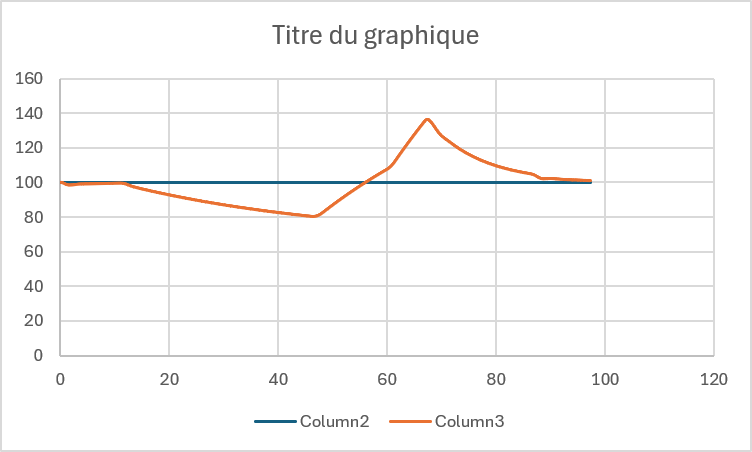

**Essai 16 — Intégration conditionnelle**

Avec l'intégration conditionnelle, la voiture ralentit également jusqu'à 80 km/h dans la montée. Cependant, après le sommet, la vitesse atteint seulement environ 102 km/h. Cette méthode réduit considérablement le dépassement en empêchant l'intégrale de s'accumuler inutilement lorsque la commande est saturée. La pédale reste au maximum pendant 42,93 secondes. 
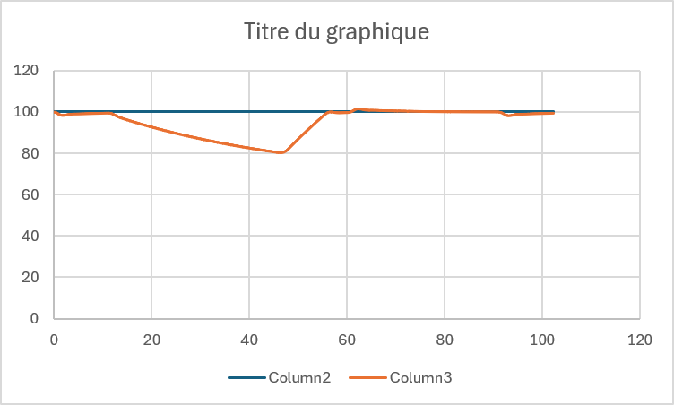

**Essai 17 — Bande autour de la consigne**

Avec la méthode de la bande, la voiture présente un comportement semblable à celui de l'intégration conditionnelle. La vitesse maximale est d'environ 102 km/h et revient rapidement près de la consigne. La pédale reste au maximum pendant 43,57 secondes
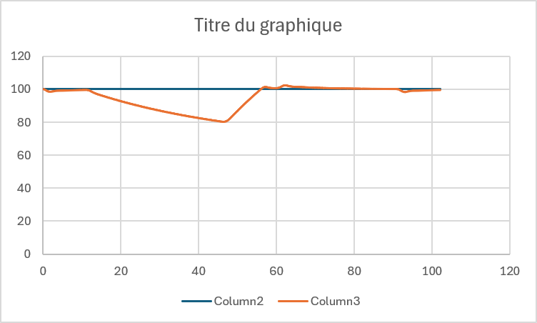

**Conclusion et recommandation**

Les deux méthodes d'anti-emballement donnent de bien meilleurs résultats que l'absence de protection. Je recommande l'intégration conditionnelle, car elle limite l'accumulation inutile de l'intégrale tout en permettant de conserver son action lorsqu'elle aide la commande à revenir dans ses limites. Les résultats des deux méthodes protégées sont toutefois très proches dans cet essai.

### Étape 8 — Réglage de la direction à plusieurs vitesses

J'ai testé mon régulateur PID de direction à 30, 60 et 100 km/h en conservant les paramètres trouvés précédemment : Kp = 0,25, Ki = 0,08333 et Kd = 0,106.

Après avoir comparé les essais, je n'ai pas observé de différence importante dans le comportement de la voiture. Elle revient au centre de sa voie sans oscillations importantes et demeure stable aux différentes vitesses.

J'ai donc décidé de conserver les mêmes gains PID pour les trois vitesses, puisque les essais ne justifiaient pas de modification.

**Table des gains retenus :**

| Vitesse | Kp | Ki | Kd |
|---|---|---|---|
| 30 km/h | 0,25 | 0,08333 | 0,106 |
| 60 km/h | 0,25 | 0,08333 | 0,106 |
| 100 km/h | 0,25 | 0,08333 | 0,106 |

**Conclusion :** Dans les conditions testées, l'augmentation de la vitesse n'a pas entraîné de dégradation importante de la stabilité. Une adaptation des gains selon la vitesse ne semble donc pas nécessaire avec mes réglages actuels.
### Étape 9 — Course finale VILLAGE (Essai 22)

**Conditions :**
- PID de direction : Kp = 0,25 ; Ki = 0,08333 ; Kd = 0,106.
- PID de vitesse : Kp = 0,4 ; Ki = 0,04 ; Kd = 0.
- Scénario : VILLAGE.

**Analyse de la vitesse :**

La voiture réussit à suivre les changements de limitation de vitesse de 90, 50, 30, 50 et 90 km/h. Elle ralentit et accélère progressivement pour atteindre les nouvelles consignes. La vitesse minimale enregistrée est de 28,972 km/h et la vitesse maximale est de 90,072 km/h.

L'erreur efficace de vitesse est de 8,193 km/h, principalement influencée par les transitions entre les consignes. Malgré cela, la voiture termine le parcours avec 0 contravention et aucun temps en excès de vitesse.

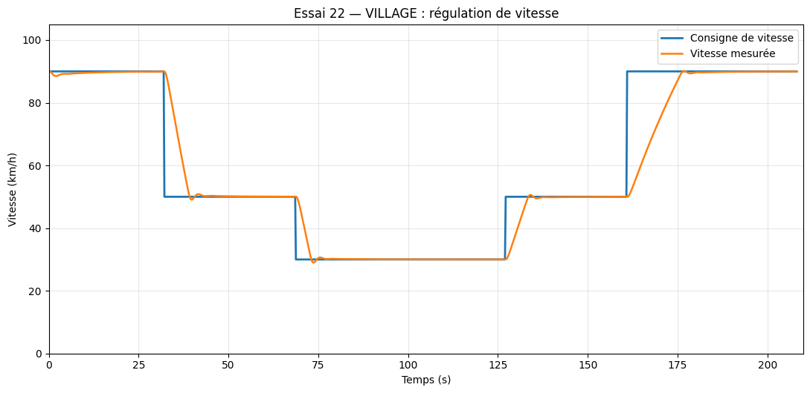
**Analyse de la direction :**

La voiture reste relativement bien centrée dans sa voie pendant tout le parcours. L'écart efficace est de 0,0379 m (3,79 cm) et l'écart maximal est de 0,1235 m (12,35 cm).

Le PID de direction permet de maintenir la voiture dans sa voie malgré les courbes et les changements de vitesse. Aucune sortie de route n'a été enregistrée.

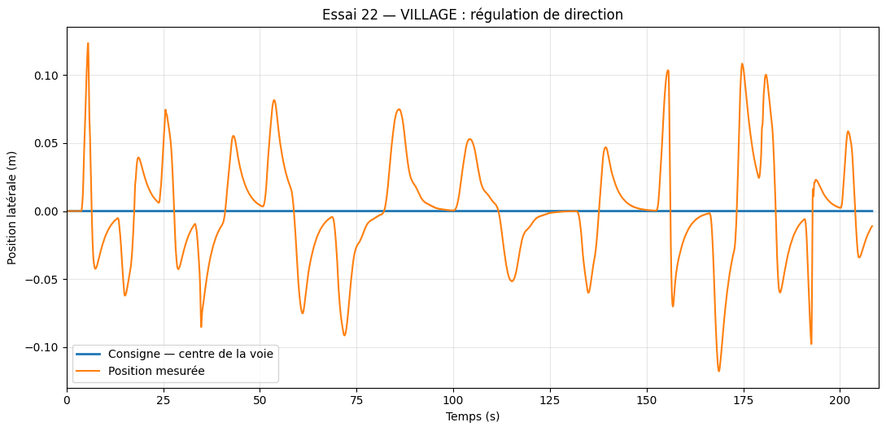

Bilan de la course :

Durée : 208,367 secondes.

Distance parcourue : 3 400,409 mètres.

Sorties de route : 0.

Contraventions : 0.

Temps en excès de vitesse : 0 seconde.

Conclusion :

Les deux régulateurs PID fonctionnent bien ensemble. La voiture respecte les limitations de vitesse et conserve une bonne stabilité de direction. Elle réussit à terminer le scénario VILLAGE sans sortie de route ni contravention.

**AUTOROUTE 

Pour cette course, j'ai utilisé les gains Kp = 0,4, Ki = 0,04 et Kd = 0 pour la vitesse, avec l'intégration conditionnelle. Pour la direction, j'ai conservé les gains Kp = 0,25, Ki = 0,08333 et Kd = 0,106.

Analyse de la vitesse

La voiture suit les changements de vitesse de 100 à 70 km/h, puis de 70 à 100 km/h. La vitesse maximale enregistrée est de 100,125 km/h. La voiture termine la course sans contravention et sans temps en excès de vitesse. Le PID de vitesse donne donc de bons résultats.
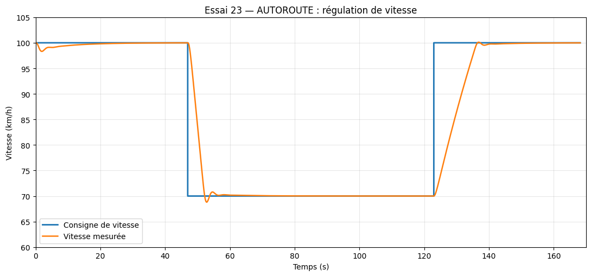

Analyse de la direction

La voiture effectue le changement de voie demandé au chantier, passant de 0 m à −3,5 m avant de revenir dans sa voie initiale. Les changements de voie causent de petits dépassements, mais la voiture se stabilise rapidement. Elle termine le parcours sans sortie de route.
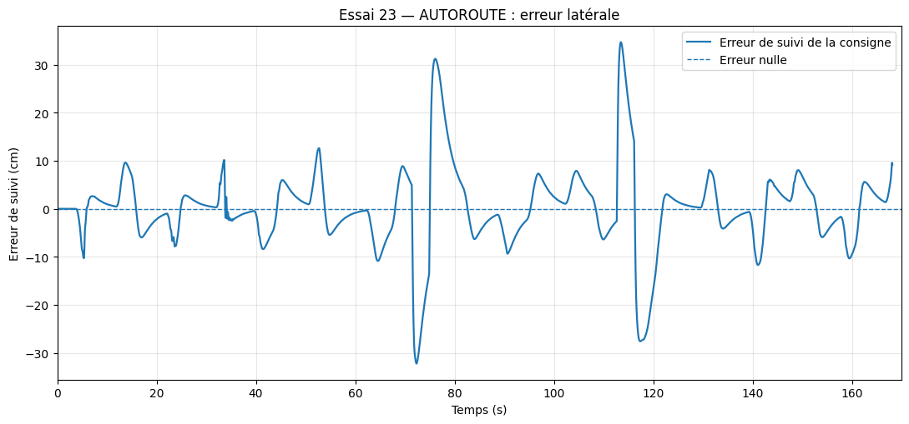

Bilan

La voiture parcourt 4 003,209 mètres en 168,233 secondes, sans sortie de route ni contravention. L'écart de voie efficace est de 0,460 m.

Le simulateur enregistre toutefois 957 échéances manquées, alors que notre boucle de commande ne signale aucun retard. Qui est du a un grand délaie de la connectiion résau.

Conclusion

Les deux régulateurs fonctionnent bien ensemble. La voiture respecte les limitations de vitesse et réussit les changements de voie. Une amélioration possible serait de réduire les dépassements pendant les changements de voie et de corriger les problèmes de communication en temps réel.

**RANG 

**Analyse de la vitesse**

Dans ce scénario, la voiture circule sur une route comportant des courbes et des vallons. Elle doit suivre les consignes de vitesse de 90, 50 et 90 km/h.

La vitesse minimale est de 48,560 km/h et la vitesse maximale de 90,651 km/h. Le régulateur réussit à maintenir la vitesse près des consignes malgré les variations du relief.
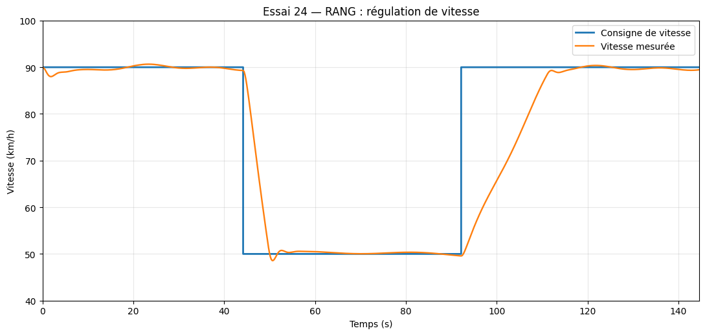

**Analyse de la direction**

La voiture demeure bien centrée dans sa voie pendant le parcours. L'écart efficace est de 3,96 cm et l'écart maximal est de 12,58 cm. Le régulateur PID de direction permet de suivre les courbes sans sortie de route.
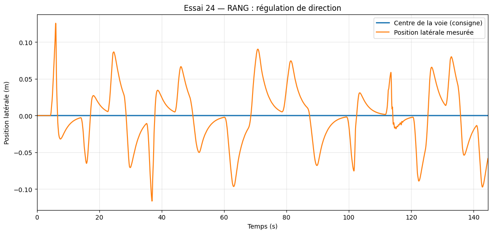

**Bilan de la course**

La voiture parcourt 3 000,603 mètres en 144,667 secondes, sans sortie de route ni contravention. Aucun temps en excès de vitesse n'a été enregistré.

Cependant, le simulateur indique 824 échéances manquées, tandis que notre boucle n'enregistre aucun retard. Cela pourrait indiquer un problème de synchronisation ou de communication.

**Conclusion**

Le scénario RANG est réussi. Les deux régulateurs PID fonctionnent correctement et permettent de maintenir une vitesse et une direction stables malgré les variations du parcours. Le principal point à améliorer reste la synchronisation avec le simulateur.